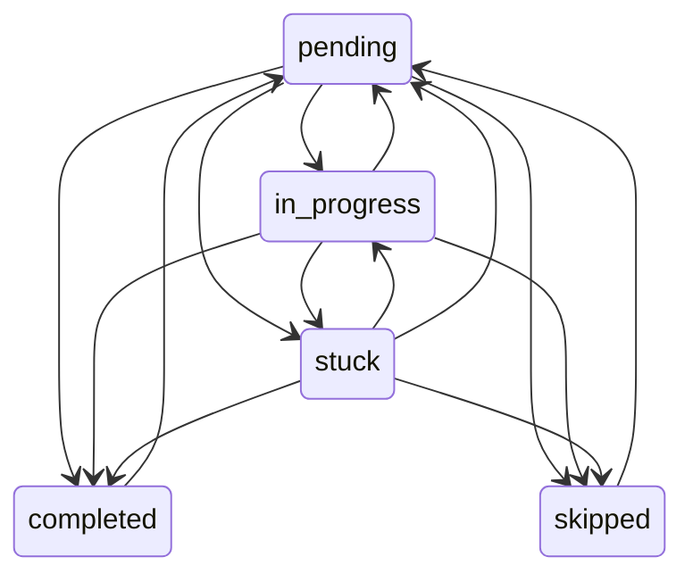

# Delivery 04 — Plan Progress

## Context

This delivery adds the plan progress domain, the effective schedule, missed-day recovery, rescheduling, skip, restore, history and undo. The final UI of the Plan page was not implemented.

## The old app's problem

The old app advanced content from the difference between the current date and the start date. The new rule is: the calendar advances with time, but the content only changes after an explicit decision.

## Base Schedule and Effective Schedule

- **Base schedule**: generated by Delivery 03 from the plan, start date and availability.
- **Effective schedule**: combines the base schedule, progress, overrides, skips, completions and reschedules.

The effective-schedule builder lives in `src/lib/domain/progress/effective-schedule.ts`.

## Progress Model

Each block has a `PlanBlockProgress` record with:

- `blockId`;
- `planDayId`;
- `planDaySequence`;
- `status`;
- `originalScheduledDate`;
- `scheduledDate`;
- start, completion and skip timestamps;
- real minutes;
- difficulty and confidence on a 1–5 scale;
- notes and the pattern used.

Rescheduling is not a primary status. A rescheduled block can stay `pending`, `in_progress` or `stuck`.

## State Machine



Invalid transitions generate `InvalidProgressTransitionError`.

## History

Relevant actions generate a `ProgressEvent`. Batch actions use `actionGroupId`, allowing groups like a schedule shift to be undone.

Events store `previousProgress` and `nextProgress` to support undo without erasing history.

## Plan Cursor

The current item is the first block not completed and not skipped in the effective schedule's order. Completing a future block out of order doesn't skip earlier pending items.

## Lateness

Lateness is derived:

```text
scheduledDate < today
status != completed
status != skipped
```

There's no persisted `missed` status.

## Rescheduling

`reschedulePlanBlock` preserves `originalScheduledDate`, updates `scheduledDate`, creates an override and an event. By default it blocks:

- a completed block;
- a skipped block;
- a rest date;
- a date before today.

Days above capacity are allowed and return a structured warning.

## Missed Day

`handleMissedStudyDay` requires an explicit strategy:

- `keep_overdue`: doesn't change dates;
- `shift_pending`: moves pending items to the next valid days;
- `reschedule_items`: requires per-item dates;
- `skip_items`: marks items as skipped.

## Shift

`shiftPendingSchedule` moves only `pending`, `in_progress` and `stuck` items from the given date on. Completed and skipped ones stay where they are.

Sunday receives no content when disabled. Partially completed days keep the completed blocks on the original date and move only the remaining blocks.

## Skip and Restore

`skipPlanBlock` marks it as `skipped`, records `skippedAt` and history. `restoreSkippedPlanBlock` goes back to `pending`. A skip doesn't count as a completion.

## Undo

`undoProgressAction` undoes an individual event or a group. It restores the previous values, removes related overrides and creates an `undone` event.

If there's a later incompatible action for the same block, the undo is blocked by `CannotUndoProgressActionError`.

## Persistence

Tables were added:

- `progressEvents`;
- `scheduleOverrides`.

Use cases live in `src/lib/application/progress` and use Dexie transactions to update progress, history and overrides together.

## Limitations

There's still no final Plan UI, Dashboard, Review Today, spaced repetition, readiness or reports. Hooks were not needed in this delivery.

## Preparation for Delivery 05

The Plan page should consume the effective schedule and this delivery's use cases, without duplicating status, lateness, rescheduling or cursor rules.
